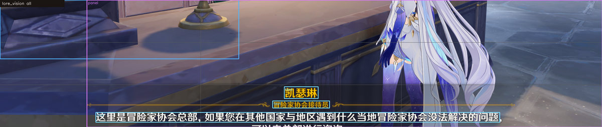
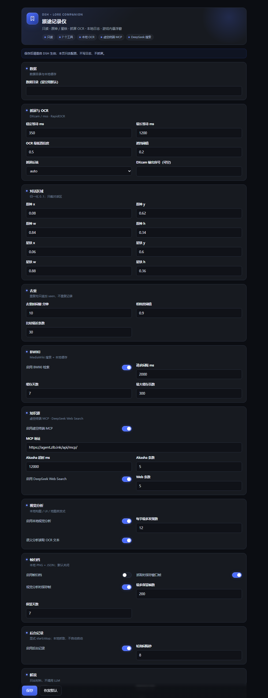

# dsh-lore-companion

A read-only Genshin Impact / Honkai: Star Rail lore companion for DeepSeek Harness (DSH).

Pipeline: **screen capture -> local OCR -> story log -> local search / wiki cache -> narration material**.

It never injects input, reads game memory, modifies game files, steals focus, or uploads screenshots/logs.

## Status

- v0.6.0 code complete: lore_status, lore_capture, lore_query, lore_narrate, lore_overlay, lore_vision, lore_watch.
- Automated tests: 62 Node tests + 28 Python tests pass.
- Verified: uv bootstrap cache hit, DXcam capture, synthetic Chinese OCR (99.7% score), real-window capture/OCR, end-to-end lore_status.
- BWIKI live: Genshin 派蒙 and HSR 三月七 both search, fetch, cache and return cleaned snippets; redirects are followed.
- Akasha live: MCP initialize + akasha_search returned five 凯瑟琳 pathHashes and parsed body snippets.
- DeepSeek web search: wired through DSH ctx.web.search(); source/URL/snippet mapping is unit-tested; the desktop provider needs an install + real call.
- Genshin real dialogue verified end-to-end: speaker 凯瑟琳, title 冒险家协会接待员, body OCR, JSONL persisted, second capture duplicate/seen, lore_query hit, lore_narrate brief.
- DSH settings page: `client.js` registers `plugins.bundle.config` and binds `configForms` to `lore-companion`; bundle registration test passes.
- In-game overlay: redesigned WPF topmost/click-through panel (blue rail, icon, status pill, gold speaker badge, choice chips); preview rendered (`docs/preview-overlay.png`); manager spawn/hide/dispose smoke passes.
- v1.3 vision alpha: `lore_vision` performs local composition/UI/map heuristics on the live window or a local PNG/JPG/WebP; real-crop end-to-end passes; annotated preview at `docs/preview-vision.png`.
- v0.3.0 frame archive: optional local window PNG + JSON (off by default), `lore_status` lists recent frames, `lore_vision` can re-analyze by `frameId`, with maxFrames/retentionDays cleanup.
- v0.4.0 local semantics: `mode=semantic` uses OCR text + geometry for scene classification (dialogue/map/menu/scene), text blocks, nearby POI labels and composition/readability advice; real crop: scene=dialogue, textBlocks=3.
- v0.6.0 background watch: `lore_watch` has explicit start/stop/status and reuses the capture pipeline; a **Start recording** pill now sits on the conversation header; unit tests cover start, duplicate/skip/empty/error, stop and double-start. Real-game long-run acceptance is still pending.
- Star Rail real dialogue, a 10-minute session, the 10-screenshot CER gate, and a real-game watch long run are still pending.

## Tools

| Tool | Purpose |
|:--|:--|
| lore_status | Engine/window/OCR/wiki/data/recent-frame status; preview=true returns the crop + OCR text |
| lore_capture | Capture the current dialogue, OCR, dedupe, append to the local log |
| lore_query | Multi-source search: local log / BWIKI / Akasha MCP / DeepSeek web search |
| lore_narrate | Build transcript/scenes/brief/prompt; does not call an LLM |
| lore_overlay | Show/hide/inspect the in-game overlay; topmost, click-through, never takes focus |
| lore_vision | Local composition / UI / map / semantic heuristics; live window, local image or frameId, optional annotated crop; no model call |
| lore_watch | Explicit start/stop/status for background polling; reuses capture, dedupe and the local log; never auto-starts |

## Main-screen start button

After installing and **fully restarting DSH**, a pill sits on the right side of the conversation header (above the Chat / Trace tabs):

- `Start recording` starts `lore_watch` with an 8-second interval; the pill turns green and becomes `Stop recording`.
- Click again to stop.
- No settings page, no chat message; it drives the same background watcher as `lore_watch`.
- If it is missing, the client bundle is stale: refresh the page first; if it still does not appear, fully quit and restart DSH.

## Knowledge sources

lore_query defaults to `scope=all` and queries four sources; a remote failure adds a warning and does not block local results:

| Source | Integration | Result |
|:--|:--|:--|
| Local log | JSONL + dedupe index | time, speaker, context |
| BWIKI | MediaWiki API + local cache | title, URL, snippet, freshness |
| Akasha | Akasha MCP akasha_search (JSON-RPC/streamable-http) | title, pathHash, snippet; use akasha_read for the full text |
| DeepSeek Search | DSH ctx.web.search() (deployed deepseek-search-api provider) | title, URL, snippet, publishedAt |

Select explicitly with `sources: ["log", "wiki"]` or `sources: ["akasha", "web"]`; the settings page can disable either remote source. The default Akasha URL is `https://agent.zlb.ink/api/mcp/` and is configurable.

## Vision analysis

`lore_vision` is local, read-only and heuristic; it never calls a model or uploads an image:

- `mode=composition`: subject box, thirds, visual weight, balance, symmetry, contrast, palette.
- `mode=ui`: coarse panel detection with top/bottom/right region labels.
- `mode=map`: POI candidates, line count and a map-likelihood score; **low confidence**, not game coordinates and not pathing.
- `mode=semantic`: local OCR scene classification (dialogue/map/menu/scene), text blocks, nearby POI labels and composition/readability advice; included in `all`.
- Default `mode=all`; without `imagePath` it captures the current game window once, with `imagePath` it analyzes a local PNG/JPG/WebP.
- `includeImage=true` returns an annotated crop attachment; live mode still enforces foreground/occlusion checks.
- `includeText=false` disables OCR for semantic mode; also available in settings.
- With frame archive enabled, `lore_vision` returns a `frameId`; re-analyze later with `{ "frameId": "...", "mode": "ui" }` without recapturing.

```json
{ "tool": "lore_vision", "mode": "composition", "imagePath": "D:/screenshots/genshin.png", "includeImage": true }
```

This is v1.3 alpha: geometry + OCR-keyword semantics, not model understanding. Optional VLM and deeper map semantics are next.



## Background watch

`lore_watch` is explicit background polling; it never starts with the plugin:

- `action=start`: capture once, then poll every `intervalSec` (2..300, default 8); default session `watch-YYYYMMDD`.
- `action=status`: running/busy/ticks/captured/duplicates/skipped/empty/errors/lastError.
- `action=stop`: clear the timer and abort the in-flight request.
- Reuses the `lore_capture` pipeline: foreground/occlusion/black-frame checks, OCR, dedupe, local log, overlay and optional frame archive; no model and no upload.
- `watch.enabled=false` refuses start; plugin dispose stops it.

```json
{ "tool": "lore_watch", "action": "start", "game": "genshin", "intervalSec": 8 }
```

## Requirements

- Windows 10/11
- DSH desktop 0.2.1-rc.2 (or compatible 0.2.x)
- Node >= 22
- Python 3.12
- uv (PATH, %USERPROFILE%/.local/bin/uv.exe, or DSH_LORE_UV)
- The game must be in borderless/windowed mode; exclusive fullscreen may produce black frames.

The plugin bootstraps a Python engine on first use (about 80 MB of wheels) under:

    %LOCALAPPDATA%/dsh-lore-companion/engine/0.1.0-<requirements hash>

Bootstrap log:

    <dataDir>/engine-bootstrap.log

Default data directory:

    %LOCALAPPDATA%/dsh-lore-companion/data

## Install (desktop)

1. Install Node dependencies in the source directory:

       cd D:/path/to/dsh-lore-companion
       pnpm install

2. DSH desktop -> Plugins -> Add plugin -> Install third-party plugin.
3. Enter D:/path/to/dsh-lore-companion -> Install -> Enable.
4. Fully quit and restart the desktop app.
5. Call lore_status in a new session and check that the engine is ready.
6. The Plugins page shows a "Lore Companion" entry and a DSH-style settings page; saving config requires a DSH restart.

For development, use an isolated profile and leave the desktop profile alone:

    %LOCALAPPDATA%/Programs/DeepSeek Harness/resources/runtime/cli/bin/dsh.cmd plugin --profile lore-dev add link:D:/path/to/dsh-lore-companion
    %LOCALAPPDATA%/Programs/DeepSeek Harness/resources/runtime/cli/bin/dsh.cmd --profile lore-dev --dump-config

Package:

    pnpm pack

## Usage

- Capture: "record this line" -> lore_capture.
- Look up: "what does that term mean?" -> lore_query (scope=all; local log + BWIKI + Akasha + DeepSeek web search).
- Narrate: "narrate this scene" -> lore_narrate; the main model writes the narration from the brief/transcript.
- Calibrate: lore_status preview=true; inspect the crop and OCR text; override with lore_capture region once or edit the config.
- Overlay: lore_overlay show / hide / status; lore_capture auto-shows it when enabled.
- Vision: "analyze this screenshot" -> lore_vision (composition/map/ui/all; optional imagePath).

## DSH UI

After install, the Plugins page shows "Lore Companion" (title/description/icon from `locale/zh.json`) with a DSH-style settings page for data dir, capture/OCR, regions, dedupe, BWIKI, Akasha, DeepSeek web search, local vision, frame archive, narration and overlay. The page uses DSH surfaces, hairline borders, a status hero, grouped cards and switches. Saves go to the volatile row config; restart DSH to apply because the engine/runtime is built at startup. The page never captures or writes logs by itself.



## In-game overlay

`overlay/overlay.ps1` is an interactive WPF panel that stays topmost without taking focus:

- 560x300 panel with a speaker badge, readable body, status pill, session/time, and four actions: **Screenshot**, **Analyze**, **Read**, **Find**.
- Drag the title bar to move it; click **—** to collapse to a 52px round ball (like an acceleration ball), click the ball to expand. Position and collapsed state persist in `layout.json`.
- **Read** captures a wider reading region and runs OCR at 1600px, for books/items/reading text; dialogue mode keeps the speech-bubble crop.
- **Screenshot** saves a local PNG under `<dataDir>/screenshots`; **Analyze** runs local vision; **Find** searches the current speaker/line across logs/Wiki/Akasha/Web.
- The panel is interactive, so it no longer passes mouse clicks through while open; it is still no-activate and never injects input or reads memory.
- Auto-hides when Genshin/HSR is not foreground unless a preview state is active; `lore_capture` auto-shows it after a successful capture.
- State: `<dataDir>/overlay/state.json`; layout: `layout.json`; commands: `command.json`; log: `overlay.log`.

The default top-right area is about 2.9% of a 2560x1440 screen, below the 20% occlusion threshold, so it does not block capture.

The default session is today-main (for example 2026-11-01-main). Session ids are limited to [A-Za-z0-9._-]{1,40}.

## Future: image element analysis

v1.3 alpha now includes local composition/UI/map heuristics and an optional frame archive. Remaining work in [ROADMAP.md](ROADMAP.md): semantic map naming, optional VLM, and stronger composition recommendations. Local by default, remote analysis opt-in, and no auto-pathing or input injection.

## Data

    <dataDir>/logs/<game>/<YYYY-MM>.jsonl
    <dataDir>/logs/index.json
    <dataDir>/wiki/<game>/pages/<sha1>.json + index.json
    <dataDir>/overlay/state.json + overlay.log
    <dataDir>/frames/<game>/<YYYY-MM-DD>/<frameId>.png + .json

JSONL is append-only; duplicate captures append a seen record, and queries fold by utteranceId. Corrupt lines are skipped and reported.

## Read-only and privacy

- Only read-only window/geometry/foreground/occlusion APIs and DXcam/mss capture.
- No SendInput / keybd_event / mouse_event / SetForegroundWindow / memory reads / injection.
- Wiki requests send only query terms and page titles to the configured BWIKI API; no screenshots, logs or session content.
- Akasha sends only the query plus world/maxResults to the configured MCP URL; DeepSeek web search sends only the query to the DSH web provider. Both can be disabled in settings.
- Data stays local. Frame archive is off by default; when enabled it writes only to the local data directory.
- No anti-cheat bypass; passive capture/OCR only.

## Verification

Automated:

    node --test
    <venv python> -m pytest engine/tests -q
    powershell -NoProfile -ExecutionPolicy Bypass -File scripts/smoke.ps1

Real-game acceptance:

1. Put each game in borderless mode and open a dialogue with a speaker and body text.
2. lore_status preview=true; inspect the crop/OCR; adjust regions if needed.
3. Capture 5–10 lines, advance, capture again; check the JSONL.
4. Cover the game with a browser; expect OCCLUDED and no log write.
5. Record for 10 minutes; find a line with lore_query.
6. Run lore_narrate and have the main model write the narration; check no spoilers/no invention.
7. Measure CER on 10 real screenshots; target >= 90%.

Detailed automated verification record: VERIFICATION.md.

See README.zh.md for the full Chinese guide, config, data schema and troubleshooting. See AGENTS.md for the repository agent contract.

## Known limits

- Exclusive fullscreen is not guaranteed to be capturable.
- OCR is imperfect; raw text and confidence are kept, no silent correction.
- BWIKI is third-party and may be stale or blocked; no cache means no fabricated answer.
- GameKee is not integrated in v1.
- lore_watch requires an explicit start and never records automatically; a real-game long run is not yet accepted.
- No web settings panel; configuration is via the profile YAML.

## License

MIT
