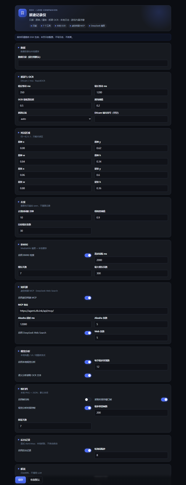
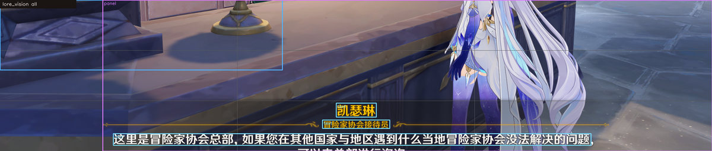

# 旅途记录仪 dsh-lore-companion

给 DeepSeek Harness（DSH）用的、面向《原神》和《崩坏：星穹铁道》的只读陪玩插件。

它做一条离线管线：**抓屏 → 本地 OCR → 剧情日志 → 本地检索 / Wiki 缓存 → 解说素材**。

- 不注入输入
- 不读游戏内存
- 不改游戏文件
- 不抢窗口焦点
- 不上传截图或日志

## 当前状态

- v0.8.0 代码已完成：lore_status / lore_capture / lore_query / lore_narrate / lore_overlay / lore_vision / lore_watch。
- 自动测试：Node 71 项、Python 33 项全部通过。
- 已实测：uv 自举（缓存命中）、DXcam 抓屏、合成中文图 OCR（99.7% 置信度）、真实窗口（Windows 设置）抓屏 + OCR、lore_status 端到端。
- BWIKI 实测：原神「派蒙」、星铁「三月七」都能搜到并写入本地缓存（各 3 页），redirect 跟随与去导航清洗已生效。
- 虚空终端实测：Akasha MCP 的 `initialize` + `akasha_search` 返回「凯瑟琳」5 个 pathHash，正文片段解析正确。
- DeepSeek Web Search：通过 DSH `ctx.web.search()` 接入，映射来源/URL/snippet；单元测试通过，桌面 provider 需要安装后实际调用。
- 截图巡检：原神 20 张 + 星铁 20 张历史截图只命中水印/UI 文本，没有找到对话截图；后来实时开游戏完成了真实验收。
- 原神无边框实测：DXcam 抓屏成功；书页「召回 / UID」和桌面多窗口误抓已被 UI/前台检查拦下。
- **原神真实对话已通过**：凯瑟琳 / 冒险家协会接待员 / 正文 / 右侧选项都能拆出；JSONL 写入、第二次抓取 duplicate+seen、按角色名查询、lore_narrate 素材都跑通。
- DSH 设置页：`client.js` 注册 `plugins.bundle.config`，`configForms` 绑定 `lore-companion`；bundle 注册测试通过。UI 改成 DSH 风格：hero、状态 chip、分组卡片、开关、粘性保存条。
- 游戏内悬浮窗：v0.8.0 可拖动、可折叠成圆球；带状态胶囊、说话人 badge、正文和截图/分析/阅读/查找按钮（`docs/preview-overlay.png`）；manager spawn/hide/dispose 冒烟通过。
- **v1.3 视觉分析 alpha 已落地**：`lore_vision` 本地分析构图/UI/地图启发式，支持实时游戏窗口或本地 PNG/JPG；真实截图端到端通过，标注图见 `docs/preview-vision.png`。
- **v0.3.0 帧归档**：可选保存窗口 PNG + JSON（默认关闭），`lore_status` 列出最近帧，`lore_vision` 可用 `frameId` 复分析；带 maxFrames/retentionDays 清理。
- **v0.4.0 本地语义**：`mode=semantic` 用 OCR 文本 + 几何做场景分类（对话/地图/菜单/场景）、文字块、POI 邻近标签和构图/可读性建议；真实截图 scene=dialogue、textBlocks=3。
- **v0.7.0 后台记录**：`lore_watch` 显式 start/stop/status，复用 capture 管线；会话标题栏右侧新增「开始记录」胶囊；unit 覆盖启动、重复/跳过/空/错误、停止和重复启动。真实游戏连续记录仍待人工验收。
- **还差**：星铁真实对话、10 分钟实录、10 张真实截图 CER ≥90%；真实游戏 lore_watch 长跑。

## 工具

| 工具 | 用途 |
|:--|:--|
| lore_status | 引擎/窗口/OCR/Wiki/数据目录/最近帧诊断；preview=true 可看裁剪图和 OCR 文本 |
| lore_capture | 抓一次当前对话，OCR、去重、写入本地剧情日志 |
| lore_query | 多源检索：本地日志 / BWIKI / 虚空终端 Akasha MCP / DeepSeek Web Search |
| lore_narrate | 把最近剧情整理成 transcript、分场景、brief 和 prompt；不调用 LLM |
| lore_overlay | 显示/隐藏/查看游戏内悬浮窗；置顶、可拖动、可折叠、不抢焦点 |
| lore_vision | 本地构图 / UI / 地图 / 语义启发式分析；实时窗口、本地图片或 frameId，可返回标注图；不调用模型 |
| lore_watch | 显式开始/停止/查看后台轮询；复用 capture 管线、去重和本地日志；不自动启动 |

## 主界面启动按钮

安装并**完全重启 DSH** 后，会话标题栏右侧（「对话 / 轨迹」上方）会出现一个胶囊按钮：

- `开始记录`：一键启动 `lore_watch`，默认 1 秒一轮；按钮变绿为 `停止记录`。
- 再点一次停止。
- 不需要打开设置页，也不需要发消息；它复用 `lore_status` / `lore_watch` 的后台记录。
- 没出现就是 client bundle 还是旧版：先刷新页面；仍没有就完全退出并重启 DSH。

## 悬浮窗

- 拖动标题栏移动；点右上角 `—` 收成 52px 圆球，圆球可拖动，单击圆球展开；位置/折叠状态存在 `layout.json`。
- `截图`：抓当前窗口保存到 `<dataDir>/screenshots`；`分析`：本地视觉分析；`查找`：用当前说话人/台词查四路资料。
- `阅读`：对更宽的阅读区域按 1600px OCR，专门处理书页/物品/任务文本；对话模式仍走气泡裁剪。
- 修复拖动时 300ms 刷新把窗口拉回原位：拖动期间暂停位置重排；血条/Lv/操作提示在 OCR 层过滤。
- 悬浮窗是可交互的置顶窗，不再鼠标穿透；仍不抢焦点、不注入输入、不读内存。

## 知识源

lore_query 默认 `scope=all`，同时查四路；网络源失败只加 warning，不阻塞本地结果：

| 源 | 接入方式 | 结果 |
|:--|:--|:--|
| 本地日志 | JSONL + 去重索引 | 时间、说话人、上下文 |
| BWIKI | MediaWiki API + 本地缓存 | 标题、URL、snippet、缓存新鲜度 |
| 虚空终端 | Akasha MCP `akasha_search`（JSON-RPC/streamable-http） | 文档标题、`pathHash`、正文片段；可用 `akasha_read` 取原文 |
| DeepSeek Search | DSH `ctx.web.search()`（部署的 `deepseek-search-api`） | 标题、URL、snippet、发布时间 |

显式选择：`sources: ["log", "wiki"]` 或 `sources: ["akasha", "web"]`；也可在设置页关掉 Akasha/Web。Akasha 默认地址为 `https://agent.zlb.ink/api/mcp/`，可改。

## 视觉分析

`lore_vision` 是本地、只读的启发式分析，不调用模型、不上传图片：

- `mode=composition`：主体框、三分法、视觉重心、平衡、对称、对比度、主色板。
- `mode=ui`：粗粒度面板检测与顶部/底部/右侧区域标注。
- `mode=map`：POI 候选、线段数量、地图可能性评分；**低置信度**，不是游戏坐标，也不做寻路。
- `mode=semantic`：本地 OCR 场景分类（对话/地图/菜单/场景）、文字块、POI 邻近标签、构图/UI 可读性建议；`all` 包含它。
- 默认 `mode=all`；不传 `imagePath` 时抓当前游戏窗口一次，传本地 PNG/JPG/WebP 时分析该文件。
- `includeImage=true` 返回标注图附件；实时模式仍受前台/遮挡检查约束。
- `includeText=false` 可关闭语义模式的 OCR；设置页也有开关。
- 开启帧归档后，`lore_vision` 返回 `frameId`；之后可用 `{ "frameId": "...", "mode": "ui" }` 复分析，不需要重新抓屏。

```json
{ "tool": "lore_vision", "mode": "composition", "imagePath": "D:/screenshots/genshin.png", "includeImage": true }
```

这是 v1.3 alpha：构图/UI 是几何启发式，地图只给候选，语义分类也只用 OCR 关键词 + 几何，不声称理解剧情或设计意图。VLM 语义仍待后续。

帧归档默认关闭，保存在本机 `<dataDir>/frames/<game>/<date>/`；启用后 `lore_status` 会列出最近帧，`lore_vision` 可用 frameId 复分析。

## 后台记录

`lore_watch` 是显式的后台轮询，不会随插件加载自动开始：

- `action=start`：立即抓一次，然后按 `intervalSec`（1..300，默认 1）轮询；默认 session `watch-YYYYMMDD`。
- `action=status`：返回 running/busy/ticks/captured/duplicates/skipped/empty/errors/lastError。
- `action=stop`：停止定时器并 abort 当前请求。
- 复用 `lore_capture` 管线：前台/遮挡/黑帧检查、OCR、去重、本地日志、悬浮窗、可选帧归档；不调用模型、不上传。
- `watch.enabled=false` 时拒绝 start；插件 dispose 会自动 stop。

```json
{ "tool": "lore_watch", "action": "start", "game": "genshin", "intervalSec": 1 }
```

## 环境要求

- Windows 10/11
- DSH 桌面版 0.2.1-rc.2（或兼容 0.2.x）
- Node >= 22
- Python 3.12
- uv（插件会自己找 PATH、%USERPROFILE%/.local/bin/uv.exe 或 DSH_LORE_UV）
- 录制时游戏切 **无边框窗口**；独占全屏可能抓到黑帧。

插件会在首次使用时自举一个 Python 引擎（约 80MB 依赖），缓存在：

    %LOCALAPPDATA%/dsh-lore-companion/engine/0.1.0-<requirements hash>

自举日志：

    <dataDir>/engine-bootstrap.log

默认 dataDir：

    %LOCALAPPDATA%/dsh-lore-companion/data

## 安装（桌面版）

1. 在源码目录装 Node 依赖：

       cd D:/path/to/dsh-lore-companion
       pnpm install

2. 打开 DSH 桌面版 → 插件 → 添加插件 → 安装第三方插件。
3. 输入本地路径 D:/path/to/dsh-lore-companion → 安装 → 启用。
4. 完全退出并重启桌面版。
5. 新会话调用 lore_status，确认七个工具出现、engine 为 ready。
6. 插件页会出现「旅途记录仪」卡片和设置页（DSH 风格），修改配置后保存并重启 DSH 生效。

开发/自动化可以用独立 profile，不要动 desktop：

    %LOCALAPPDATA%/Programs/DeepSeek Harness/resources/runtime/cli/bin/dsh.cmd plugin --profile lore-dev add link:D:/path/to/dsh-lore-companion
    %LOCALAPPDATA%/Programs/DeepSeek Harness/resources/runtime/cli/bin/dsh.cmd --profile lore-dev --dump-config

打包分享：

    pnpm pack

生成 dsh-lore-companion-0.8.0.tgz，可在插件 UI 用本地压缩包安装。

## 首次自举与镜像

首次运行会下载 numpy / onnxruntime / opencv / rapidocr / dxcam / mss。PyPI 慢时先设镜像：

    $env:UV_INDEX_URL='https://mirrors.aliyun.com/pypi/simple/'
    $env:UV_DEFAULT_INDEX='https://mirrors.aliyun.com/pypi/simple/'
    $env:PIP_INDEX_URL='https://mirrors.aliyun.com/pypi/simple/'

然后重启桌面版或重新调用 lore_status。

## 用法

- “记一下这段” → lore_capture。
- “刚才那句‘契约之神’是什么意思？” → lore_query（scope=all；本地日志 + BWIKI + 虚空终端 + DeepSeek 搜索）。
- “给我解说刚才这段” → lore_narrate，主模型用返回的 brief/transcript 写解说。
- 校准：lore_status preview=true，看裁剪图、OCR 文本、region.method；如果裁错，用 lore_capture 的 region 参数覆盖一次，或改配置。
- 看书/物品/任务文本：lore_capture mode=read。
- “把悬浮窗打开/关掉” → lore_overlay show / hide；lore_capture 成功后默认自动显示。
- “分析这张截图的构图/地图” → lore_vision（mode=composition/map/ui/all；可传 imagePath）。

lore_capture 的 session 默认是“当天日期-main”，例如 2026-11-01-main；可以在参数里指定，只允许 [A-Za-z0-9._-]{1,40}。

## DSH 界面

装好后，DSH 侧栏「插件」里会出现「旅途记录仪」条目（标题/描述来自 locale/zh.json），bundle 详情页有设置页：

- 数据目录、抓屏与 OCR 参数、原神/星铁区域、去重、BWIKI、虚空终端、DeepSeek Web Search、视觉分析（含语义 OCR 开关）、帧归档、解说默认值、悬浮窗开关与位置
- 使用 DSH 暗色表面、细边框、蓝色强调、状态胶囊与自定义开关；插件卡片有自定义 icon
- 保存写入 profile 的 row config；因为引擎/运行时在启动时构建，保存后**重启 DSH 生效**
- 页面本身不抓屏、不写日志

客户端半侧是 `client.js`（手写 ModuleLoader bundle，无构建步骤），通过 `configForms` 编辑 `lore-companion` 的 volatile row config。



## 游戏内悬浮窗

`overlay/overlay.ps1` 是一个 **WPF 置顶、鼠标穿透、不抢焦点** 的小窗：

- 显示：状态、说话人/头衔、正文、右侧选项、session/时间
- 默认位置右上，480×220，深色 DSH 风格（左侧蓝轨、状态胶囊、金色说话人 badge、选项 chip）；可配置 top-left / top-right / bottom-center
- 默认只在原神/星铁前台显示（autoHideOnGameLost），鼠标事件穿透到游戏
- `lore_capture` 成功后按 `overlay.autoShow` 自动显示；`lore_overlay show|hide|status` 手动控制
- 状态文件：`<dataDir>/overlay/state.json`；日志：`<dataDir>/overlay/overlay.log`
- 悬浮窗不注入输入、不读内存；它是独立 PowerShell 进程，不改变游戏

悬浮窗是独立窗口，会被算进遮挡面积；默认右上、面积约 2.9%，低于 20% 遮挡阈值，不会挡住抓屏。

## 后续：更深的视觉分析

v1.3 alpha 已把 composition / ui / map 的本地启发式接进 `lore_vision`，并加入可选帧归档；剩余在 [ROADMAP.md](ROADMAP.md)：语义地图、可选 VLM、构图建议的更强模型。默认仍本地，远程需 opt-in，不做自动寻路或输入注入。



## 数据

    <dataDir>/logs/<game>/<YYYY-MM>.jsonl
    <dataDir>/logs/index.json
    <dataDir>/wiki/<game>/pages/<sha1>.json + index.json
    <dataDir>/overlay/state.json + overlay.log
    <dataDir>/frames/<game>/<YYYY-MM-DD>/<frameId>.png + .json

日志是追加式 JSONL，一条对话一行；重复识别只追加 seen 记录，查询时按 utteranceId 折叠。坏行读取时跳过并报告，不阻塞查询。

日志记录示例：

    {"v":1,"op":"dialogue","id":"...","utteranceId":"...",
     "ts":"2026-11-01T05:10:00.000Z","tz":"Asia/Shanghai",
     "game":"genshin","session":"2026-11-01-main",
     "kind":"dialogue","speaker":"派蒙","text":"旅行者，我们走吧！",
     "lines":[{"text":"旅行者，我们走吧！","score":0.98}],
     "capture":{"window":"原神","process":"YuanShen.exe","region":{...},
                "foreground":true,"occludedRatio":0,"backend":"dxcam"}}

## 配置

插件的 bundle patch 只插入一行：

    - insert:
        - id: lore-companion
          name: dsh-lore-companion

需要改默认值时，在 profile 的 cordis.patch.yml 里按 id 覆盖：

    - id: lore-companion
      config:
        dataDir: 'D:/path/to/dsh-lore-companion/data'
        capture:
          occlusionThreshold: 0.2
          settleMs: 350
        regions:
          genshin: {x: 0.08, y: 0.62, w: 0.84, h: 0.34}
          hsr: {x: 0.06, y: 0.60, w: 0.88, h: 0.36}
        wiki:
          enabled: true
          requestIntervalMs: 2000
        sources:
          akasha:
            enabled: true
            url: 'https://agent.zlb.ink/api/mcp/'
          web:
            enabled: true
        vision:
          enabled: true
          maxFindings: 12
          includeText: true
        frames:
          enabled: true
          saveOnCapture: true
          saveVision: true
          maxFrames: 200
          retentionDays: 7
        watch:
          enabled: true
          intervalSec: 1
        overlay:
          enabled: true
          autoShow: true
          position: top-right

可配置项见 lib/config.js；环境变量覆盖：

- DSH_LORE_DATA_DIR
- DSH_LORE_UV
- DSH_LORE_PYTHON
- DSH_LORE_ENGINE_DIR
- DSH_LORE_CACHE_DIR
- DSH_LORE_OFFLINE=1（只用 Wiki 缓存，不联网）
- DSH_LORE_DEBUG=1（引擎错误带 traceback）

## 只读与隐私

- 引擎只调用窗口枚举、几何、前台、遮挡等只读 Win32 API；抓屏用 DXcam/mss。
- 没有 SendInput / keybd_event / mouse_event / SetForegroundWindow / 内存读写 / 注入。
- Wiki 只发查询词和页面标题到配置的 BWIKI API；不发截图、日志或会话内容。
- Akasha 只发查询词和 world/maxResults 到配置的 MCP URL；DeepSeek Web Search 只发查询词到 DSH web provider。两者都可用设置页关闭。
- 数据只写本机 dataDir 和引擎缓存。`lore_vision` 的 imagePath 是本地只读文件；实时模式只抓当前游戏窗口，分析不上传。帧归档默认关闭，开启后也只写本机 dataDir。
- 反作弊：本插件不绕过、不注入；只做被动抓屏/OCR。是否使用由你决定。

## 故障排查

| 现象 | 处理 |
|:--|:--|
| 引擎装不上 | 看 engine-bootstrap.log；确认 uv；设 DSH_LORE_UV；慢就设镜像；删 engine/0.1.0-<hash> 重试（不影响日志） |
| CAPTURE_BLACK | 游戏切无边框；关 HDR/覆盖层；确认未最小化；独占全屏不支持 |
| OCCLUDED | 把游戏放前台，移开遮挡窗口；不要用 force 掩盖真实遮挡 |
| WINDOW_NOT_FOUND | lore_status 看可见窗口；确认进程是 YuanShen.exe / StarRail.exe |
| 裁剪错位 / 多屏 | lore_status 看 monitors/outputs；用 capture.outputIndex 指定 DXcam 输出 |
| BWIKI 567/WAF | 客户端已限流退避；不要提高并发；可设 DSH_LORE_OFFLINE=1；或让模型用 akasha_search 查官方原文 |
| JSONL 坏行 | 读取会跳过并报 corruptLines；先备份再处理 |
| 悬浮窗不显示 | 看 <dataDir>/overlay/overlay.log；确认 PowerShell 可用；先调 `lore_overlay show`；位置可能被其他置顶窗口盖住 |
| 悬浮窗挡视线 | 设置页改 position/width/height，或 `lore_overlay hide`；默认右上 460×200 |

## 验收

自动测试：

    node --test
    <venv python> -m pytest engine/tests -q
    powershell -NoProfile -ExecutionPolicy Bypass -File scripts/smoke.ps1

真实游戏验收（需要你配合）：

1. 两款游戏各切无边框，站到有说话人 + 正文的对话前。
2. lore_status preview=true，看裁剪图和 OCR 文本；必要时调 regions。
3. 连续 lore_capture 5–10 句，推进对话再记；检查 JSONL。
4. 用浏览器盖住游戏，确认 OCCLUDED 且不写日志。
5. 10 分钟实录；lore_query 用一句特征台词找回上下文。
6. lore_narrate 出 brief，主模型据此写一段解说，检查不剧透/不编造。
7. 10 张真实截图 CER >=90%，把结果补进本节。

详细自动化验收记录见 VERIFICATION.md。

## 已知限制

- 独占全屏不保证可抓屏。
- OCR 对游戏字体/背景仍有误差；日志保留原始文本和置信度，不静默纠正。
- BWIKI 是第三方来源，可能过时或被 WAF 拦截；无缓存时不编造。
- GameKee 未接入；v1 只做 BWIKI。
- lore_watch 需要显式 `start`，不自动记录；真实游戏长跑尚未验收。
- 没有 Web 设置面板；配置走 profile YAML。

## 开发

仓库级 agent 说明见 AGENTS.md，包含只读红线、环境事实、架构、命令、测试和排障。改代码前先读它。

## License

MIT

## 旅途视图

DSH 会话顶部新增「旅途」视图（在「对话 / 轨迹」后面）：

- 人物与事件：出场人物卡片、人物同场次数关系条、按 6 分钟间隔切分的事件梗概；点人物或事件跳到对应对话。
- 详细对话：说话人、头衔、时间、正文、选项；支持按台词/角色/头衔搜索，按事件分组。
- 场次切换：原神 / 星穹铁道、每个 watch-YYYYMMDD 场次；只读本地 JSONL，不调用模型、不上传。
- 事件梗概是抽取式：取事件最早两句原文，不做语义编造；人物关系按同场事件计数。
- 实现：lib/journal.js 聚合快照，lib/journal-remote.js 经 Typert 暴露，client 注册 conversation.view。

## 旅途 2.0

- 人物关系图谱：环形 SVG，节点大小按出场行数，连线粗细按同场事件次数；点节点直接筛对话。
- 事件时间线：竖向轨道 + 事件节点，保留时间、角色和抽取式梗概。
- 详细对话：说话人头像色块、搜索高亮、逐句复制、事件分组。
- 导出：一键下载 Markdown 或 JSON，数据只在本地生成。

## 低延迟对话跟随

- 后台记录默认 1 秒一轮（原 8 秒），按钮启动也用 1 秒。
- watch 走 fast 路径：跳过 350–1200ms 的稳定等待，不做每帧区域检测。
- 三套自适应裁切：底部对话条 → 下半区宽裁 → 中下全宽；连续空帧会切换，覆盖原神新旧对话框。
- 自动播放/快速点击时优先保证不漏行，抽帧不再等画面“完全稳定”。

## 强制记录与截图管理

- 悬浮窗新增「强制」按钮：跳过对话判定，直接按当前裁切 OCR 并写入日志；仍不绕过 OCR，画面没字就失败。
- 「截图」保存到 `<dataDir>/screenshots`，同时写 sidecar JSON 和 480px 缩略图。
- 「旅途」新增「截图」tab：缩略图网格、说话人/台词/时间、点击看原图、可删除。
- 截图与日志都只在本地，不上传；删除只影响本地文件。

## AI 整理稿

- 使用 minimax-m3.1 子代理清理 OCR 剧情：合并重复、修正错别字、补标点、按场景分段。
- 结果写入 `<dataDir>/journal/curated.json` 和 `curated.md`；旅途新增「整理稿」tab。
- 不新增原文没有的剧情；无法确认处标注「OCR 存疑」。
- 旅途默认只显示最近 300 行，可切换 300/600/1200，或点「重置视图」。

## 全片剧情梗概

- 对完整场次（10:22–17:01，清理后 2260 行）做 4 块 minimax-m3.1 梗概，合并为 9 个剧情阶段。
- 「旅途」新增「剧情梗概」tab；数据在 `<dataDir>/journal/synopsis.json`。
- 梗概只依据录制文本，标注 OCR 存疑；不补写未记录的剧情。

## 0.17.0 修复

- 悬浮窗按钮命令改为无 BOM UTF-8，Node 同时兼容 BOM；截图/分析/阅读/查找/强制不再被静默丢弃。
- 新增 `PUNCT_ONLY`：角色沉默只显示「……」时，低置信度省略号不再被短行过滤器删除，可正常记录。
- 日志视图把「纳西姐/茜特莉/伊湿芙/九条装罗」等 OCR 说话人变体归并到常用译名。

## lore_story：给 QQ 机器人用的剧情接口

- DSH 工具 `lore_story`，只读本地记录。
- `action=summary` 返回整场 9 段梗概；`search` 查台词；`character` 查角色；`scene` 查阶段；`recent` 最近台词；`stats` 统计。
- 返回的 `text` 是可直接发到 QQ 的纯文本。
- QQ 桥接的 `plugins/qq-agent-presets/qq-tool-restrict.mjs` 已放行 `lore_story`；需要重启 QQ 桥接或新建会话让工具 schema 生效。

## 0.17.0 界面

- 旅途页改成阅读型布局：顶部英雄区、场次/时间胶囊、四个统计卡、吸顶分段导航。
- 剧情梗概增加章节索引、时间线节点、场景卡和阅读排版；点击章节可直接跳转。
- 截图、事件卡、人物卡统一细边框/渐变表面；支持键盘焦点与 reduced-motion。
- 游戏内悬浮窗改为深蓝渐变、柔和描边、状态光点和更宽松的正文行高。

## 0.17.0 锚点与记忆

- 悬浮窗折叠/展开固定右上角：球停靠面板右上角，展开向左、向下生长；拖动面板后不会在 300ms 刷新时回弹。
- OCR 低置信度（<0.62）时对裁切区域做 1.5x 放大重识别，保留更高分/更完整结果。
- 新增结构化记忆 `journal/memory.json`：阶段、人物、关系、未解决线索、最近对白；`lore_story` 增加 `memory` 与 `context`。
- `context` 输出当前阶段、最近对白、在场人物、线索和受控陪玩 prompt。
- 调研与实时陪玩路线见 [docs/REALTIME-COMPANION.md](docs/REALTIME-COMPANION.md)。

## 0.17.0 主线/世界任务

- 新增 `<dataDir>/journal/quests.json` 场次映射：`type=main|world|activity|story`，`name` 为任务名。
- 示例见 [docs/quests.example.json](docs/quests.example.json)。
- 旅途顶部显示「主线 · 圣土化」或「世界任务 · 新基捷」徽章。
- 梗概按场次绑定：选中世界任务场次时不会再把主线的 9 段梗概套过去；世界任务整理稿需要单独生成。
- 默认打开有主线的场次；世界任务仍可从场次下拉选择。
